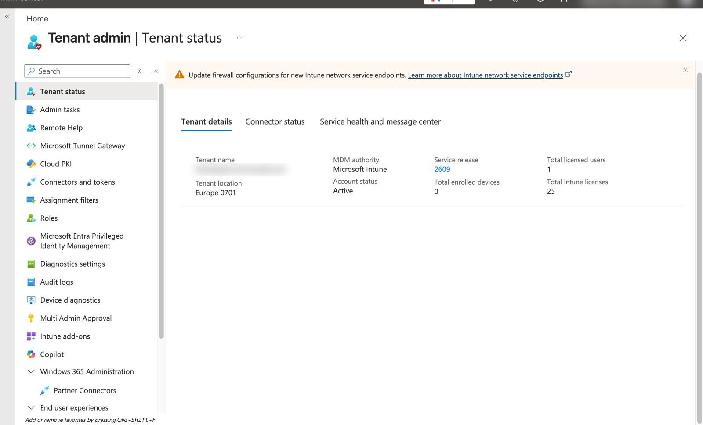

# Day 2 – Intune free trial and tenant

**Goal:** my own "company" (tenant) in Microsoft's cloud, with me as the admin.

**Concept:** a **tenant** is the company's private space in Microsoft's cloud (e.g. `<tenant>.onmicrosoft.com`). Users, devices, policies and licenses all live inside it.

## Before starting

- Personal email, phone for SMS, bank card (verification only)
- New Chrome profile **"Intune Lab"** (regular mode)
- Microsoft Authenticator app on the phone

## Steps

1. Searched "Microsoft Intune free trial" > learn.microsoft.com > **Intune set up account** link.
2. Entered personal email > Next > **Set up account** (chose a new account, not an existing one).
3. Company details: smallest company size, country Germany.
   - *Company size* doesn't affect price or features.
4. Verified the phone with an SMS code.
5. Chose username and domain → admin login `<admin>@<tenant>.onmicrosoft.com`.
6. Added the card for verification and finished.

## Admin MFA

*Why:* Microsoft requires MFA for all admin portals, and as the only admin, losing access would lock me out of the whole lab.

1. Went to **https://aka.ms/mfasetup** > left menu **Security info**.
2. **+ Add sign-in method** > Microsoft Authenticator > scanned the QR code with the phone app (+ > Work or school account).
3. Approved the test number.
4. Added **Phone (SMS)** as a backup method.

> If no MFA prompt appears when opening Intune, that's normal: the browser session is already signed in. A private window shows the prompt.

## Check the tenant

Intune admin center > **Tenant administration > Tenant status**

| Field | Value |
| --- | --- |
| MDM authority | Microsoft Intune |
| Account status | Active |
| Total Intune licenses | 25 |
| Total enrolled devices | 0 (enrollment is Day 4) |

## Billing safety

Microsoft 365 admin center > **Billing > Your products** > Microsoft Intune Plan 1 Trial > **Recurring billing = Off**.

*Why:* trials with a card can turn into paid subscriptions automatically. With recurring billing off, the trial simply ends.

## The three admin portals

| Portal | Address | Simple meaning | Used for |
| --- | --- | --- | --- |
| Microsoft 365 admin center | admin.microsoft.com | Money office | Licenses, billing, trials |
| Entra admin center | entra.microsoft.com | ID card office | Users, groups, sign-in, Conditional Access |
| Intune admin center | intune.microsoft.com | Laptop office | Devices, policies, apps |

"Tenant administration" is a section **inside** Intune for Intune's own settings, not a separate portal.
