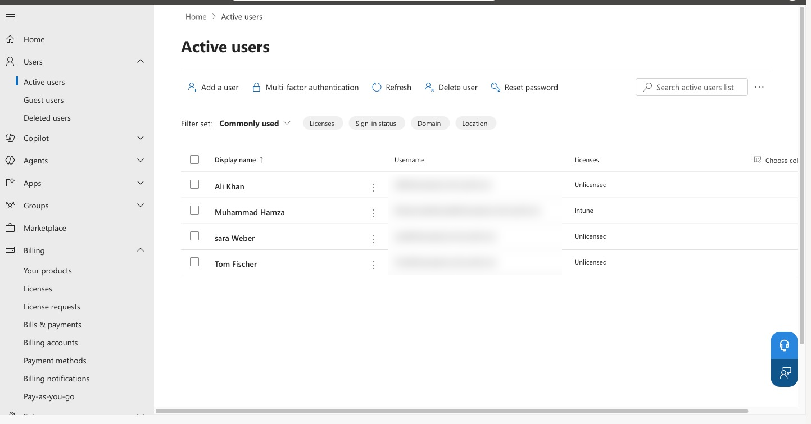
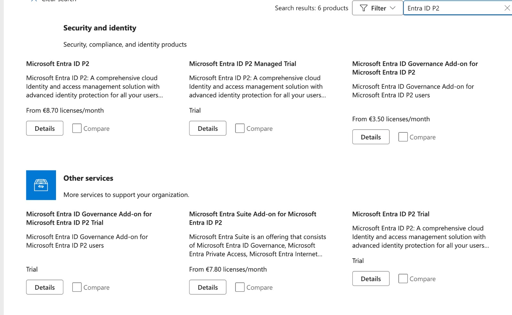
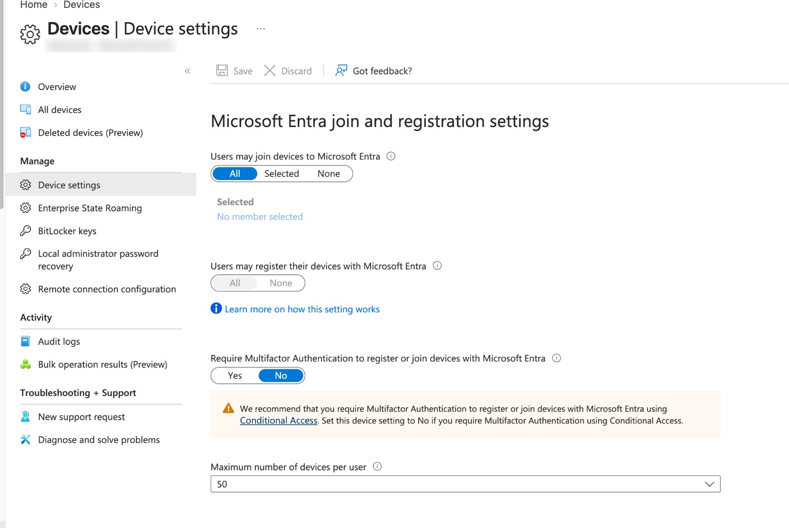

# Day 3 – Users, groups and licenses

**Goal:** fake employees and teams, so every policy later has someone to target.

## 1. Create users

Entra admin center > **Users > All users > + New user > Create new user**

| Display name | Username | Department |
| --- | --- | --- |
| Ali Khan | ali | HR |
| Sara Weber | sara | Sales |
| Tom Fischer | tom | IT |

- Password: auto-generated, written down (needed on Day 4).
- Properties tab: **Usage location = Germany**. *Why:* licenses can't be assigned without a usage location.

## 2. Assign Intune licenses

*Why:* a license is a "work permit". Without it, Intune won't manage the user's devices.

Microsoft 365 admin center > **Billing > Licenses** > Microsoft Intune Plan 1 Trial > **+ Assign licenses** > Ali, Sara, Tom > Assign.

> **Stuck point:** "Manage product licenses" from the Active users list showed nothing. Assigning from the **license side** (Billing > Licenses) worked.

## 3. Create assigned groups

Entra admin center > **Groups > All groups > + New group**

| Group | Type | Membership | Members | Why |
| --- | --- | --- | --- | --- |
| Lab-Users | Security | Assigned | Ali, Sara, Tom | "All employees", main target for policies |
| Lab-HR | Security | Assigned | Ali | Practice targeting one team |

- **Security** groups are for permissions and policies. Microsoft 365 groups are for shared mailboxes and Teams.
- **Assigned** = members added by hand.

## 4. Add Entra ID P2 (needed for dynamic groups)

Entra admin center > Overview > License showed **Microsoft Entra ID Free**. Dynamic groups and Conditional Access need **P1 or higher**, and Intune Plan 1 doesn't include it.

1. Microsoft 365 admin center > **Marketplace** > search box "Entra ID P2".
2. Picked **Microsoft Entra ID P2 Trial** (shows "Trial", not a price). Avoided the paid version and the "Managed Trial".
3. Details > **Start free trial** > **Try now** (total €0.00). The €8.70 shown is the price *after* the trial.
4. Billing > Your products > P2 trial > **Recurring billing = Off**.
5. Billing > Licenses > P2 trial > assigned to Ali, Sara, Tom and the admin.
6. Entra Overview now shows **Microsoft Entra ID P2** (can take 10–30 minutes).

## 5. Create the dynamic device group

Entra admin center > Groups > + New group

- Group type: Security · Name: **Lab-Windows-Devices** · Membership type: **Dynamic Device**
- Add dynamic query: Property `deviceOSType`, Operator `Equals`, Value `Windows`
- Rule: `(device.deviceOSType -eq "Windows")` > Save > Create
- Shows **0 members** until Win11-Lab is enrolled on Day 4.

> **Stuck point:** the Create button was greyed out. Fix: make sure the rule is actually saved (button changes to "Edit dynamic query") and that Membership type still says Dynamic Device.

**Concept:** a dynamic group only sorts devices that are **already in the tenant's device list**. A device gets on that list only when a company user joins it with their company account (or IT registers it with Autopilot).

## 6. Allow device join

Entra admin center > **Devices > Device settings** > Users may join devices to Microsoft Entra = **All**.

*Why:* without this, Ali can't join the VM to the company on Day 4.

## Licensing cheat sheet

| License | Intune | Entra P1 | Entra P2 |
| --- | --- | --- | --- |
| Microsoft 365 Business Basic / Standard | No | No | No |
| Microsoft 365 Business Premium (≤300 users) | Yes | Yes | No |
| Office 365 E1 / E3 | No | No | No |
| Microsoft 365 E3 | Yes | Yes | No |
| Microsoft 365 E5 | Yes | Yes | Yes |
| EMS E3 / E5 | Yes | Yes | E5 only |

- **Office 365** = Office apps + email. **Microsoft 365** = Office 365 + device management and security.
- Conditional Access and dynamic groups need **Entra ID P1**.

## Concept check

- **Entra** = *who* the person or device is (identity). Old name: Azure Active Directory.
- **Intune** = *what* the device must do (policies, apps, security).
- The only rule so far is the dynamic group's **membership rule**. Real device rules start on Day 5.
