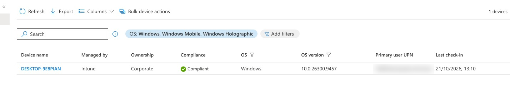

# Day 4 – Enroll the device into Intune

**Goal:** the employee's laptop (Win11-Lab) becomes a managed company device.
**Result:** device `DESKTOP-9E8PIAN`, managed by Intune, ownership **Corporate**, primary user Ali.

## In Intune (admin computer)

1. **Devices > Enrollment > Windows > Automatic Enrollment**
2. **MDM user scope = All**, WIP user scope = None > Save
   - *Why:* tells Microsoft to hand every company-joined Windows device to Intune.
   - WIP (Windows Information Protection) is retired. MAM is for personal devices.

## On the device

1. VirtualBox snapshot **"Before enrollment"** – a one-click way back.
2. **Settings > Accounts > Access work or school > Connect** > leave the email box empty > click the link **"Join this device to Microsoft Entra ID"**.
3. Signed in as the employee, set a new password (temporary passwords must be replaced).
4. "Make sure this is your organization" > **Join** > Done.
5. Restart > **Other user** > signed in with the company account.
   - *Why:* the join changes the **device**, not the signed-in person. The local admin account stays as a backup.

> ⚠️ **Join vs register** – typing the email into the Connect box only **registers** the device (personal / BYOD, ownership *Personal*, no company sign-in). The **Join** link makes it a **company** device. This mistake happened on Day 8, see [troubleshooting](troubleshooting.md).

## Checks

| Where | What | Result |
| --- | --- | --- |
| Intune > Devices > Windows | Device listed | Managed by Intune, Corporate, primary user |
| Device > Access work or school > Info > Sync | Forces a check-in | Last sync = now |
| Device > `dsregcmd /status` | Join state | `AzureAdJoined : YES`, `DomainJoined : NO` |
| Entra > Groups > Lab-Windows-Devices | Dynamic group | Device added by the rule automatically |

## Concepts

- The Windows computer name (`DESKTOP-…`) is different from the VirtualBox name.
- **Sync** only speeds things up; devices check in by themselves every few hours and after Intune's wake-up notification.
- At scale nobody joins by hand: **Windows Autopilot** uses a list of hardware hashes (uploaded by the seller or imported as CSV) so laptops join and enroll during setup. Apple uses **Apple Business Manager**, Android uses **zero-touch / Knox**.
