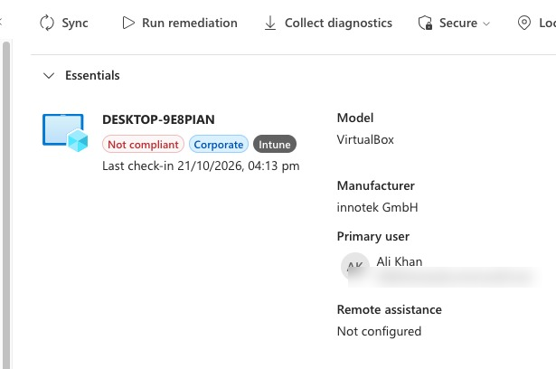
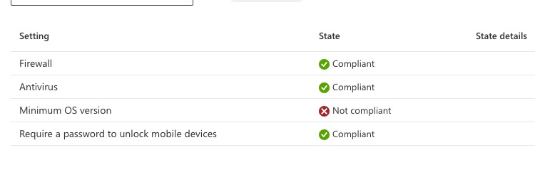
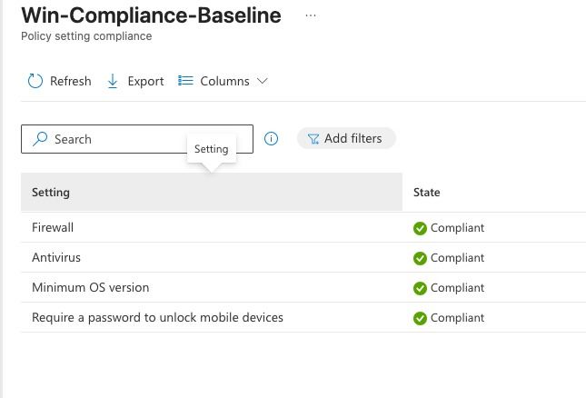

# Day 5 – Compliance policies

**Goal:** Intune checks whether the device is safe and marks it **Compliant** or **Not compliant**.

**Concept:** a compliance policy is a checklist for a safe device, like the security check at an office entrance. It only **checks and reports**; it changes nothing. A *policy* is the container, each *setting* inside is one rule. One failing rule = the whole policy is Not compliant.

## Steps

1. **Devices > Compliance > Compliance settings:** "Mark devices with no compliance policy assigned as" = **Not compliant** (unsafe until proven safe).
2. **Policies > + Create policy** (not *Policy set*) > Windows 10 and later > Windows 10/11 compliance policy.
3. Name: `Win-Compliance-Baseline`.
4. Rules: Minimum OS version (device's current version), Require a password, Firewall, Antivirus.
5. Action for noncompliance: mark noncompliant immediately (real companies often use a 1–3 day grace period).
6. Assigned to **Lab-Users** (users, so the rule follows the person to every device).

## Break it on purpose

1. Raised Minimum OS version above the device's version.
2. Sync → device turned **Not compliant**; the per-setting report showed exactly which rule failed.
3. Set it back → **Compliant** again.

## Secure Boot in a VM

The Secure Boot rule showed **Error**. Intune checks it via *Device Health Attestation*, which needs a signed report from the TPM; VirtualBox's virtual TPM can't produce one. Windows Security confirmed Secure Boot was on, so the rule was removed for the lab. On real hardware it works.

## Concepts

- Compliance = the **grade**. Conditional Access (Day 7) = the **door** that checks the grade. Check first, block later.
- The built-in **Default Device Compliance Policy** always appears next to your own (checks: policy assigned, device active within the validity period, user still exists).
- In a real company: agree rules with security, pilot group, grace period, watch reports, then enforce with Conditional Access.
