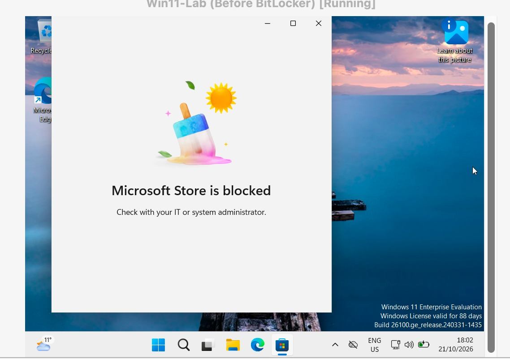
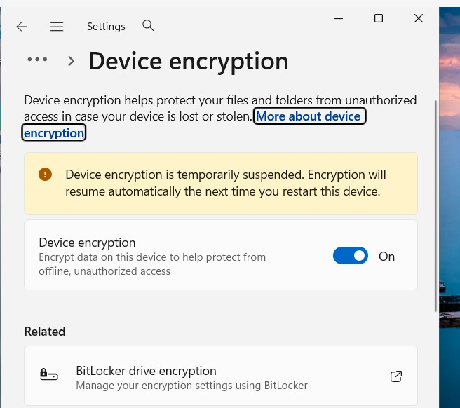
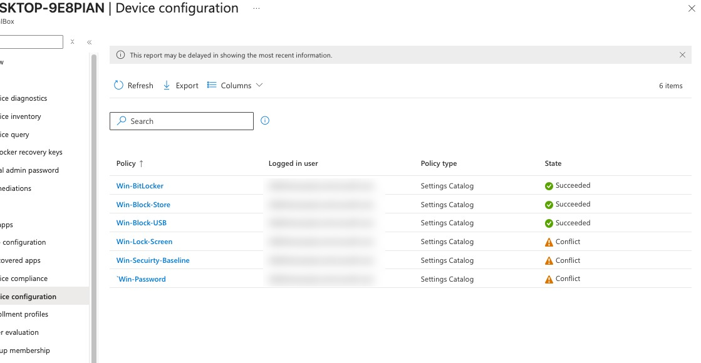

# Day 6 – Configuration profiles

**Goal:** Intune **changes** real settings on the device. (Compliance checks, configuration changes.) Results: Succeeded / Error / Conflict.

Path: **Devices > Configuration > + Create > New policy > Windows 10 and later > Settings catalog**, assigned to **Included groups > Lab-Users**.

| Profile | Setting | Value | Why | Proof |
| --- | --- | --- | --- | --- |
| Win-Block-USB | Administrative Templates > System > Removable Storage Access > All Removable Storage classes: Deny all access | Enabled | USB sticks leak data and bring malware | Succeeded |
| Win-Lock-Screen | Local Policies Security Options > Interactive Logon Machine Inactivity Limit | 300 s | Unlocked unattended laptops expose data | Locked after 5 idle minutes |
| Win-Password | Device Lock > Device Password Enabled + Min Device Password Length | Enabled, 8 | Short passwords are guessed fast | Local account forced to change password |
| Win-Block-Store | Administrative Templates > Windows Components > Store > Turn off the Store application | Enabled | Apps come from IT, not the Store | Store "blocked" |
| Win-BitLocker | see below | | Stolen laptop = lost hardware, not lost data | Device encryption On, key in Intune |
| Win-Security-Baseline | Endpoint security > Security baselines (defaults) | | Microsoft's expert security pack | Succeeded after fixing conflicts |

## BitLocker (silent, TPM, key escrowed first)

| Setting | Value | Why |
| --- | --- | --- |
| Require Device Encryption | Enabled | Main switch |
| Allow Warning For Other Disk Encryption | Disabled | No pop-up → silent |
| Allow Standard User Encryption | Enabled | Works for non-admins (appears after the previous one is Disabled) |
| Configure Recovery Password Rotation | Refresh on for Entra-joined devices | New key after a key is used |
| Enforce drive encryption type (OS drives) | Used Space Only | Fast |
| Require additional authentication at startup | Enabled, all options *Allow* | TPM unlocks automatically; any *Require PIN* breaks silent encryption |
| Choose how OS drives can be recovered | Enabled → save to AD DS (= Entra) True, passwords + key packages, **don't enable until stored = True** | Never a locked disk without a saved key |

OS-drive settings live under *Administrative Templates > Windows Components > BitLocker Drive Encryption > Operating System Drives* (search "operating system drives").

**TPM** = a small security chip, the laptop's vault: stores keys (BitLocker, Windows Hello PIN), checks that startup wasn't tampered with, creates signed health reports.

## Conflicts

The baseline also set the inactivity limit, password length and password history → three profiles in **Conflict** (Intune applies neither value).

**Fix:** set those settings to **Not configured** in the baseline. Rule: each setting lives in one place. *Disabled* is still a value; *Not configured* means "leave it alone".

## Concepts

- Finding settings: start from the goal, search short keywords, read the (i) info, use baselines / CIS Benchmarks / Microsoft Learn, test on one device first.
- Reports lag: after a night offline the Sync status showed 7/7 while the report showed one profile – the device tests proved the rules were applied.
- Two sign-ins: Windows unlocks locally, but the cloud token can expire separately.
