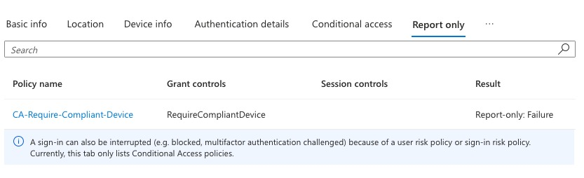
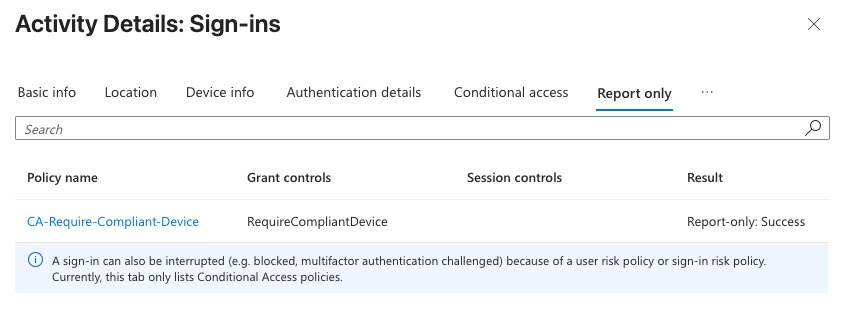

# Day 7 – Conditional Access and apps

**Goal:** only compliant devices reach company apps, and Intune installs apps without the user.

## Part A – Conditional Access (CA)

CA is the guard at the door of company apps: **IF** (who, what, which device) **THEN** (allow, block, require more).

1. **Entra > Overview > Properties > Manage security defaults = Disabled** (all-or-nothing, can't run with CA).
2. **CA-Require-MFA-All-Users** – All users, All resources, Require MFA, **On**.
   - *Why:* turning security defaults off removes the rule that asks for MFA. Having Authenticator registered ≠ being required to use it.
   - Admin **not** excluded (admins need MFA most; real companies exclude only a break-glass account).
3. **CA-Require-Compliant-Device** – Include Lab-Users, **Exclude the admin** (admin's computer isn't managed), All resources, Require compliant device, **Report-only** first.
4. Sign-in logs > sign-in > **Report-only** tab: unmanaged Mac = *Failure* (would block), company laptop = *Success*.

5. Switched to **On**. Unmanaged Mac: MFA → "Set up your device to get access" (the block page). Company laptop: allowed via SSO.

**Closing the gap** (employee enrolls a personal device to get access): enrollment restrictions (block personally owned, device limit), Autopilot / corporate identifiers, "users may join devices" = Selected.

## Part B – Apps

| App | Type | Assignment |
| --- | --- | --- |
| Microsoft Edge | Microsoft Edge (built-in) | Required |
| Company Portal | Microsoft Store app (new) | Required |
| Microsoft PowerToys | Microsoft Store app (new) | Available |
| Microsoft To Do | Microsoft Store app (new) | Required |
| 7-Zip | Windows app (Win32), packaged by hand | Required |

- **Required** = must have (installs automatically). **Available** = nice to have (user installs from Company Portal). **Uninstall** = must not have.
- Company Portal = the company app shop: approved self-service apps, compliance status, IT contact.
- Store (new) and Win32 apps need the **Intune Management Extension** on the device; the first install takes longer.

## Packaging 7-Zip (Win32)

1. Folders `IntuneApps\Source` and `IntuneApps\Output`.
2. 7-Zip 64-bit installer from 7-zip.org → Source.
3. **Microsoft Win32 Content Prep Tool** (GitHub, Download ZIP) – kept **outside** Source.
4. `IntuneWinAppUtil.exe` → source folder, setup file, output folder, catalog N → `.intunewin`.

| Setting | Value |
| --- | --- |
| Install command | `7z<version>-x64.exe /S` (capital S = silent) |
| Uninstall command | `"C:\Program Files\7-Zip\Uninstall.exe" /S` |
| Install behavior | System |
| Requirements | x64 only |
| Detection | File exists `C:\Program Files\7-Zip\7z.exe` |

In a real company IT packages once on its own computer and Intune delivers to every laptop. Pre-packaged catalogs exist (Enterprise App Management, Patch My PC), but company-specific software always needs packaging.
