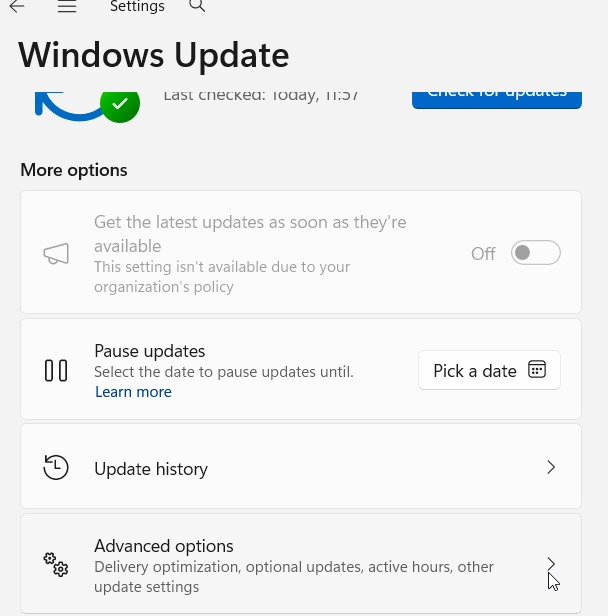
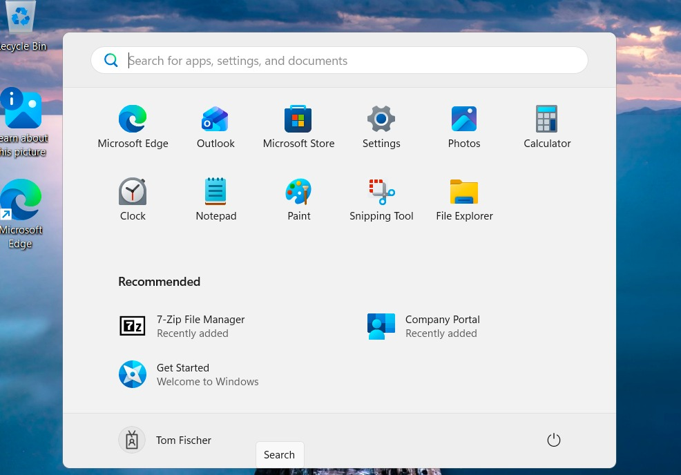

# Day 8 – Updates and device lifecycle

## Part A – Windows updates

| Policy | Settings | Why |
| --- | --- | --- |
| Update ring **Ring-Pilot** | Quality and feature deferral 0 days, Lab-Users | Pilot gets updates first; a broad ring would wait e.g. 7 days |
| Feature update **FU-Win11-Current** | Newest Windows 11 version | Keeps everyone on one tested version (needs Windows Enterprise E3/E5) |

Quality updates = monthly security fixes. Feature updates = the big yearly upgrade.

Proof: Windows Update shows "This setting isn't available due to your organization's policy".

Tip: *Option to pause Windows updates = Disable* greys out the Pause button. Update ring **deadlines** force restarts users keep postponing.

## Part B – Remote actions

| Action | What it does | When |
| --- | --- | --- |
| Sync | Check in now | After changing a policy |
| Restart | Restart remotely (user gets a warning, can dismiss) | After updates |
| Retire | Removes company data/apps only | Personal device, employee leaves |
| Wipe – Reset and remove all data | Factory reset | Company device returned |
| Wipe – Reset but keep user data | Reinstall, keep files | Repair for the same person |
| Erase device | Strongest erase | Stolen laptop with sensitive data |
| Fresh Start | Reinstall Windows, stay enrolled | Slow/messy device |

## Part C – Offboarding (employee leaves)

Order matters – **cut access first**:

1. Snapshot "Before wipe" (lab only).
2. **Entra:** block sign-in (Account enabled off) + **Revoke sessions**.
3. **Intune:** Wipe → *Reset and remove all data*. Wipe stays *Pending* (other actions greyed out) until the device checks in – it doesn't need anyone to sign in.
4. **Microsoft 365 admin center:** unassign licenses.

What happened in the lab:
- A restart showed the **BitLocker recovery screen** → matched the Key ID in Intune, typed the 48-digit key.
- The reset filled the Mac's disk and crashed VirtualBox → restored the snapshot to free space.
- Intune marked the wipe complete and removed the device → the restored VM was **orphaned** (Entra joined, not managed). Never un-wipe in real life.

## Onboarding the next employee

Restored an earlier snapshot and joined the laptop as the next employee. Every policy and app arrived automatically because everything is assigned to **groups** – nothing had to be recreated.

After a wipe a device always enrolls again – with **Autopilot** that happens automatically when the next user signs in during Windows setup.
