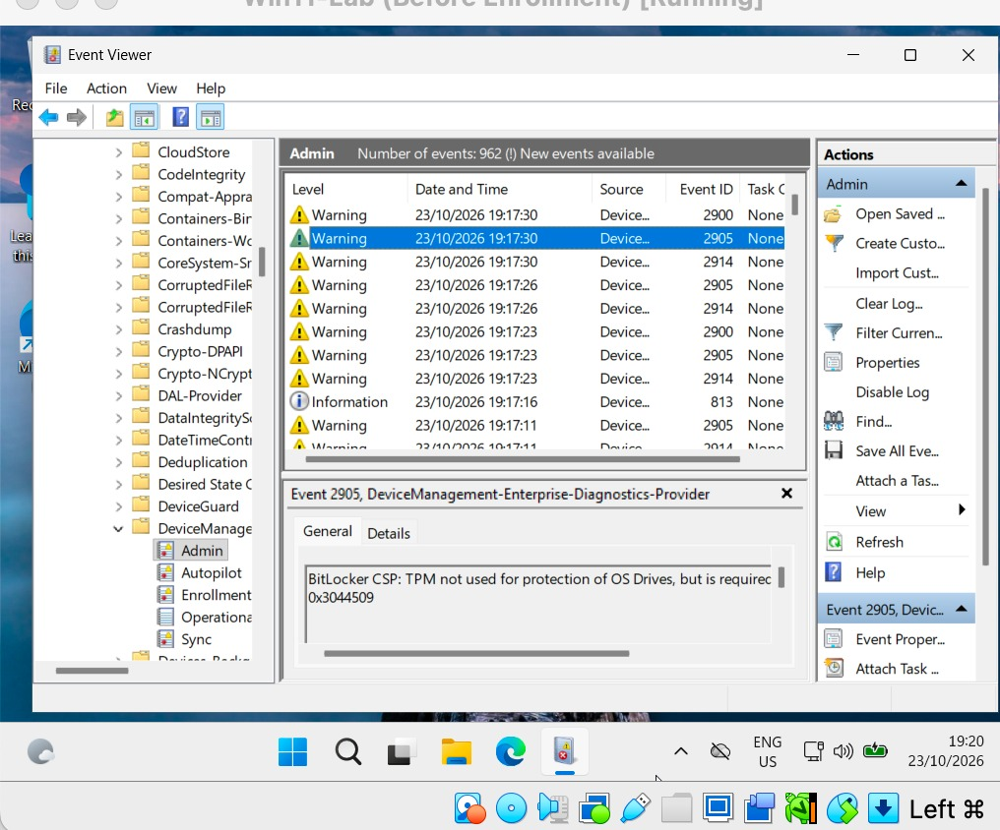
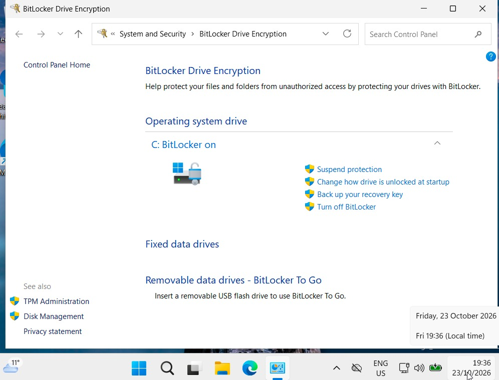

# Day 9 – Troubleshooting practice

**Goal:** know where to look when something fails. Full symptom guide: [troubleshooting.md](troubleshooting.md).

## Where to look

| Problem | Where to look |
| --- | --- |
| Device not joined / sign-in token problems | Device: `dsregcmd /status` (AzureAdJoined, AzureAdPrt) |
| Policy not applying | Event Viewer > Applications and Services Logs > Microsoft > Windows > DeviceManagement-Enterprise-Diagnostics-Provider > Admin |
| Full MDM report | Settings > Accounts > Access work or school > Export your management log files |
| Win32 / Store app not installing | `C:\ProgramData\Microsoft\IntuneManagementExtension\Logs` and the app's install status in Intune |
| User blocked unexpectedly | Entra > Sign-in logs > sign-in > Conditional Access / Report-only tabs |
| Remote action stuck | Intune > Devices > Monitor > Device actions |
| Encryption state | Intune > Devices > Monitor > Encryption report; device: Manage BitLocker |

## Real case: BitLocker "waiting for activation"

1. **Symptom:** Event Viewer full of warnings (event IDs 2900, 2905, 2914) on the new employee's laptop.
2. **Log message:** *BitLocker CSP: TPM not used for protection of OS Drives, but is required* (0x3044509).
   
3. **Confirm on the device:** Manage BitLocker said *waiting for activation*.
4. **Cause:** encryption started, then the VM was paused (host disk full) and powered off – the TPM protector was never added.
5. **Fix:** restart; recovery key appeared in Intune, Manage BitLocker said *BitLocker on*, warnings stopped.

   

## Real cases from earlier days

| Planned exercise | What actually happened |
| --- | --- |
| Conflicting profiles | Day 6: security baseline vs own profiles → set baseline settings to *Not configured* |
| User outside the assigned group | Day 6: Lab-Users under *Excluded* groups → moved to *Included* |
| Device in the wrong join state | Day 8: device only *registered* (email typed in Connect) → disconnected and used the *Join* link |

The routine: **vague problem → right log → exact message → confirm on the device → cause → fix → verify.**
